# Teclado "MIDI" digital com STM32F103C8T6

Projeto final da disciplina de **Microprocessadores** do curso de Engenharia da Computação da **UNOESC Joaçaba** (2026/2), com o professor Kleyton Hoffmann.

A ideia era responder uma pergunta: dá para fazer um instrumento musical de verdade usando só o que já vem dentro de um STM32 Blue Pill, sem nenhum módulo de áudio? Deu. O resultado é um teclado de 10 teclas com 15 timbres, som estéreo, várias notas ao mesmo tempo, menu num display OLED e um modo em que ele toca músicas MIDI inteiras enviadas pelo computador via Bluetooth, com bateria e tudo.

<p align="center">
  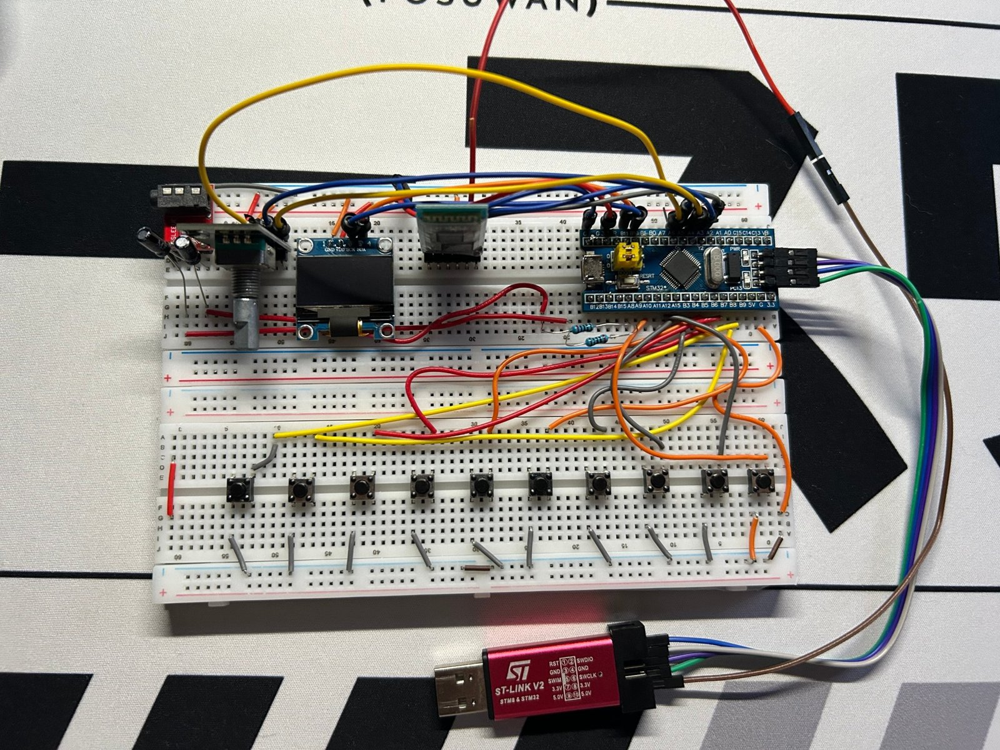
</p>

**Equipe:** Felipe Fidel Fleck, Pedro Henrique Pascotto Dahmer e Thiago Biazus Maran.

---

## Sumário

1. [O que ele faz](#o-que-ele-faz)
2. [Fotos e vídeos](#fotos-e-vídeos)
3. [Hardware](#hardware)
4. [Como o código está organizado](#como-o-código-está-organizado)
5. [Como o som é gerado (`audio.c`)](#como-o-som-é-gerado-audioc)
6. [Teclas e encoder (`input.c`)](#teclas-e-encoder-inputc)
7. [Telas e menu (`app.c`)](#telas-e-menu-appc)
8. [Comandos pelo Bluetooth (`cmd.c`)](#comandos-pelo-bluetooth-cmdc)
9. [Músicas RTTTL e MIDI (`rtttl.c`, `midi.c`, `enviar_midi.py`)](#músicas-rtttl-e-midi)
10. [Como montar e gravar](#como-montar-e-gravar)
11. [Resultados](#resultados)
12. [Limitações e próximos passos](#limitações-e-próximos-passos)
13. [Créditos](#créditos)

---

## O que ele faz

- 10 teclas, de Dó4 a Mi5, com a nota de cada uma configurável
- 15 timbres: quadrada, triangular, senoidal, serra, piano, órgão, flauta, clarinete, cordas, trompete, violão, sino, ocarina, piano elétrico e bateria
- Até 10 notas ao mesmo tempo nas teclas e 16 nas músicas, em estéreo
- Display OLED mostrando a nota, a frequência, o timbre e um menu controlado pelo encoder
- Comandos pelo Bluetooth (HC-05) para trocar timbre, volume, notas das teclas e até os parâmetros de cada instrumento
- Toca músicas RTTTL coladas no terminal e músicas MIDI enviadas pelo computador, que ficam gravadas na flash mesmo depois de desligar

## Fotos e vídeos

| Tela inicial | Uma nota | Acorde | Tocando um MIDI |
|:---:|:---:|:---:|:---:|
| 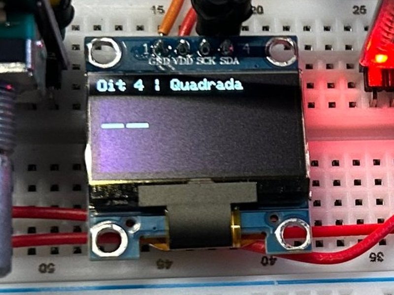 | 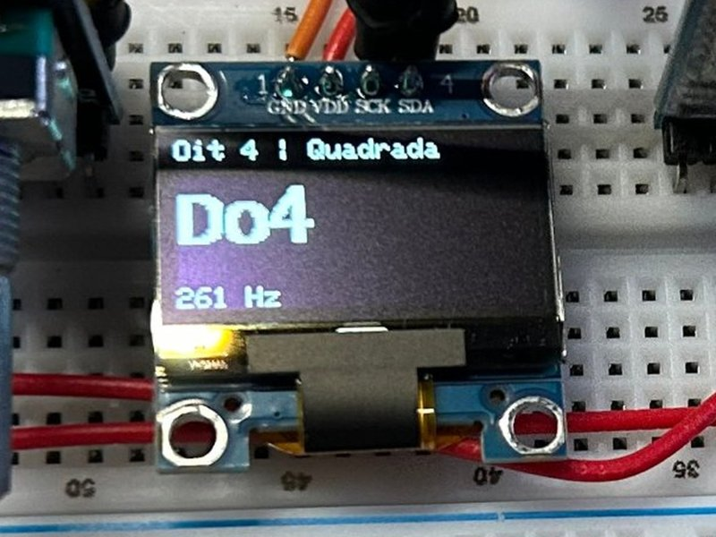 | 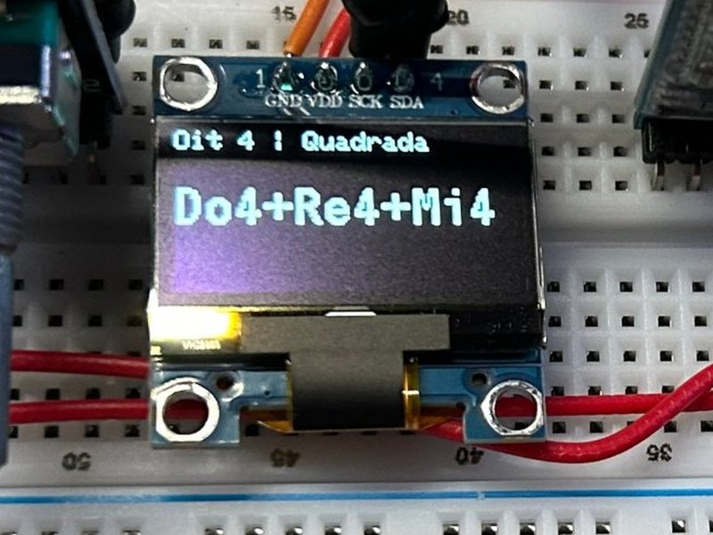 | 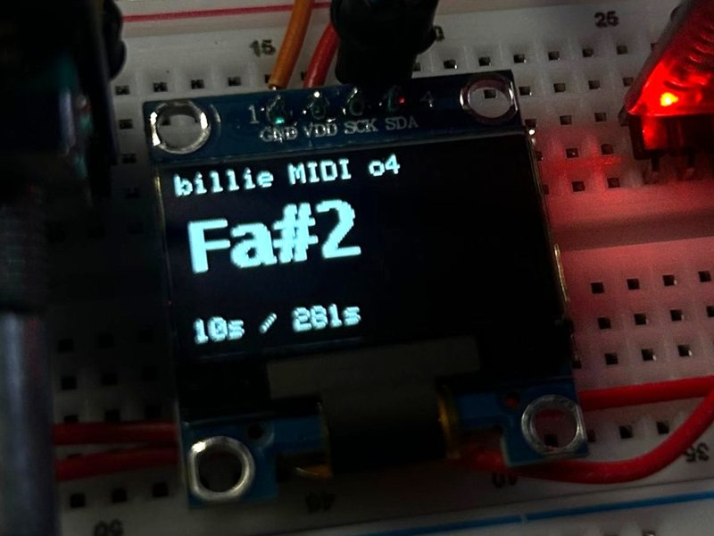 |

| Menu | Volume | Timbre |
|:---:|:---:|:---:|
| 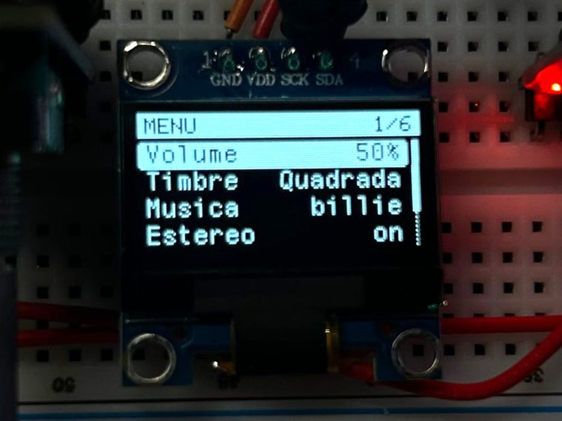 | 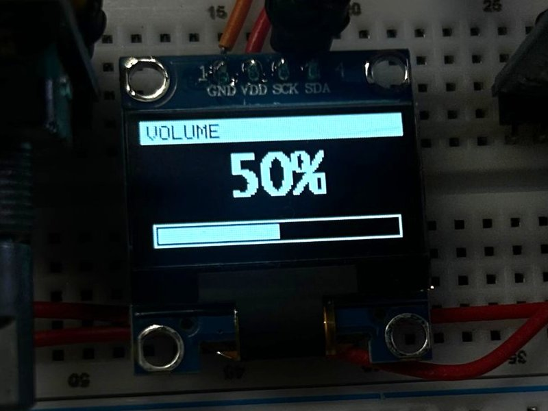 | 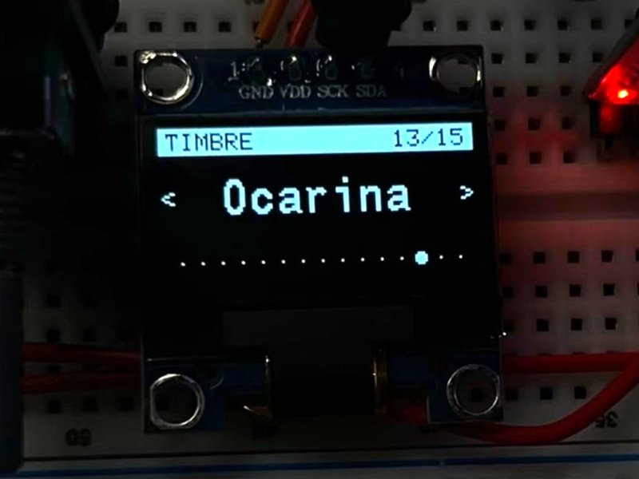 |

**Vídeos:** [pasta no Google Drive](LINK-DO-DRIVE), com gravações desde a primeira versão, ainda no ESP32.

<!-- Para mostrar um vídeo direto aqui: edite este arquivo no GitHub e arraste o .mp4 para esta linha. -->

O andamento do projeto (compras, datas e tarefas) está no nosso [quadro do Trello](https://trello.com/b/7kRg3o1v/projeto-microprocessadores).

---

## Hardware

| Componente | Qtd. |
|---|:---:|
| Blue Pill (STM32F103C8T6) + gravador ST-Link V2 | 1 |
| Chaves táteis (teclas) | 10 |
| Encoder rotativo KY-040 | 1 |
| Display OLED 0,96" 128×64 (SSD1306, I2C) | 1 |
| Módulo Bluetooth HC-05 | 1 |
| Resistor 2,2 kΩ | 2 |
| Capacitor eletrolítico 10 µF | 2 |
| Conector P3 estéreo | 1 |
| Protoboard, jumpers e uma caixa de som amplificada | — |

### Ligações

| Peça | Pino da peça | Blue Pill |
|---|---|---|
| Teclas 1 a 10 (Dó4 … Mi5) | um lado | PB9, PB8, PB7, PB6, PB5, PB4, PB3, PA15, PA12, PA10 |
| | outro lado | GND |
| Encoder KY-040 | CLK / DT / SW | PA4 / PA5 / PA6 |
| | + / GND | 3,3 V / GND |
| Display OLED (I2C2) | SCL / SDA | PB10 / PB11 |
| | VCC / GND | 3,3 V / GND |
| HC-05 (USART2) | TXD / RXD | PA3 / PA2 (cruzado) |
| | VCC / GND | 5 V do ST-Link / GND |
| Áudio esquerdo | TIM1 CH1 | PA8 → 2,2 kΩ → 10 µF → ponta (*Tip*) do P3 |
| Áudio direito | TIM1 CH2 | PA9 → 2,2 kΩ → 10 µF → anel (*Ring*) do P3 |
| P3 | luva (*Sleeve*) | GND |

As teclas ligam o pino ao GND; o pull-up interno do STM32 mantém o pino em nível alto quando a tecla está solta.

No áudio, o resistor limita o sinal e o capacitor tira a parte contínua do PWM (que fica em torno de 1,65 V), deixando passar só o som. O PWM roda a cerca de 140 kHz, muito acima do que dá para ouvir, então a própria caixa de som filtra o resto.

> O STM32F103C8T6 **não tem DAC**. Na proposta inicial a gente contava com um, e foi o professor quem apontou isso e sugeriu o PWM. No fim, foi a parte mais interessante do projeto.

---

## Como o código está organizado

```
Core/
├── Inc/                 cabeçalhos (.h) de cada módulo
└── Src/
    ├── app.c            laço principal, telas do display e menu
    ├── audio.c          geração do som (o coração do projeto)
    ├── input.c          leitura das teclas e do encoder
    ├── cmd.c            comandos recebidos pelo Bluetooth
    ├── rtttl.c          músicas no formato RTTTL
    ├── midi.c           músicas MIDI: recepção, gravação na flash e reprodução
    └── ssd1306*.c       biblioteca do display (afiskon/stm32-ssd1306, MIT)
ferramentas/
└── enviar_midi.py       converte um .mid e envia para o teclado
referencia_cubemx/       exemplo do que o CubeMX gera, só para comparar
```

O `main.c` é o que o STM32CubeMX gera; a única coisa que colocamos nele foi a chamada de `app_init()` e `app_loop()`. Todo o resto está nos módulos acima.

---

## Como o som é gerado (`audio.c`)

### PWM + DMA no lugar do DAC

O **TIM1** conta de 0 a 511, o que dá um PWM de 9 bits a 72 MHz / 512 ≈ 140 kHz nos canais 1 e 2 (esquerdo e direito). O contador de repetição do TIM1 (RCR = 6) faz o timer pedir uma amostra nova a cada 7 períodos, ou seja, **20.089 amostras por segundo**.

Quem entrega essas amostras é o **DMA1, canal 5**, em modo *burst*: a cada pedido do TIM1 ele copia dois valores do buffer na RAM direto para os registradores CCR1 e CCR2. O processador não participa disso.

```c
HAL_DMA_Start_IT(dma, (uint32_t)buf, (uint32_t)&tim->Instance->DMAR, BUF_AMOSTRAS * 2);
tim->Instance->DCR = TIM_DMABASE_CCR1 | TIM_DMABURSTLENGTH_2TRANSFERS;   /* 2 registradores por vez */
```

O buffer tem duas metades de 64 amostras. Enquanto o DMA toca uma, o processador calcula a outra. As interrupções de "meio" e "fim" do DMA avisam qual metade ficou livre:

```c
static void dma_meia(DMA_HandleTypeDef *h)  { render(&buf[0], AUDIO_BLOCO); }
static void dma_cheia(DMA_HandleTypeDef *h) { render(&buf[AUDIO_BLOCO * 2], AUDIO_BLOCO); }
```

### Vozes

Cada nota tocando é uma **voz**. São 26 no total: 10 para as teclas e 16 para as músicas. A cada bloco de 64 amostras, cada voz calcula a sua parte e soma na mistura.

**Oscilador.** A forma de onda de cada timbre é uma tabela de 256 pontos (um ciclo). Para tocar uma nota, a voz anda por essa tabela mais rápido ou mais devagar: o quanto ela anda por amostra (`inc`) é calculado a partir da frequência da nota, com um acumulador de fase de 32 bits. O valor entre dois pontos da tabela é interpolado para a onda ficar suave. Tudo com números inteiros, porque o Cortex-M3 não tem unidade de ponto flutuante.

<p align="center">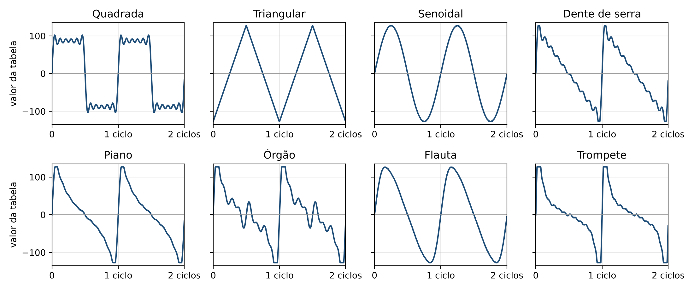</p>

**Envelope (ADSR).** É o que faz um piano soar diferente de um órgão. Cada voz passa por quatro etapas: ataque, decaimento, sustentação e soltura. O piano, por exemplo, tem sustentação zero (o som vai sumindo mesmo com a tecla apertada); o órgão sustenta no volume máximo.

<p align="center">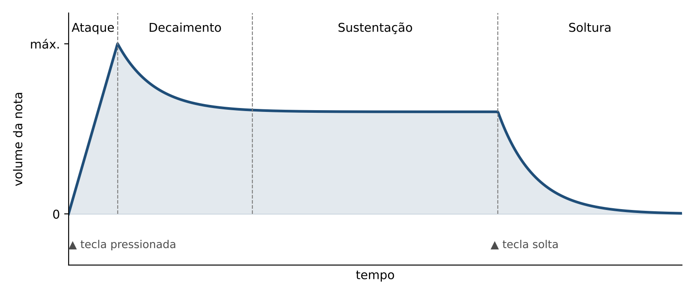</p>

**Timbres.** Além das ondas básicas, os instrumentos usam tabelas montadas por soma de harmônicos e alguns truques:

- **vibrato**, uma pequena oscilação na frequência (flauta, cordas, ocarina);
- **filtro de brilho**, que deixa o som mais abafado conforme a nota perde volume (piano, violão, trompete);
- **chorus**, um segundo oscilador levemente desafinado somado ao primeiro (piano, órgão, cordas);
- **síntese FM**, uma senoide modulando a outra, para os sons metálicos do sino e do piano elétrico.

Os parâmetros de cada timbre ficam na tabela `INSTR[]` e podem ser alterados pelo Bluetooth com o comando `inst`.

**Bateria.** Também é sintetizada: bumbo e tons são uma senoide com a frequência caindo rápido; caixa, chimbal e pratos são ruído gerado por um *xorshift*, com durações e filtros diferentes. O canal 10 dos arquivos MIDI vai para esses sons, e o timbre "Bateria" coloca bumbo, caixa, chimbal e pratos nas teclas.

**Mistura.** Somar 20 notas estouraria o PWM. Por isso o ganho da mistura diminui conforme o número de notas (mais ou menos 1/√n) e um limitador suave arredonda os picos em vez de cortar. Cada voz tem um ganho para o lado esquerdo e outro para o direito, que é o que posiciona os instrumentos no estéreo.

### Otimização

Na primeira versão, o programa calculava amostra por amostra, passando por todas as vozes a cada vez, e as músicas mais pesadas chegavam a 78% da CPU. Hoje cada voz calcula o **bloco inteiro de 64 amostras de uma vez**, com os seus dados em variáveis locais (que o compilador deixa nos registradores). Isso cortou o uso da CPU praticamente pela metade. O `audio.c` também é compilado sempre com `-O2`, por causa de um `#pragma` no começo do arquivo.

---

## Teclas e encoder (`input.c`)

As teclas **não usam interrupção externa**: elas são lidas dentro da própria interrupção do áudio, a cada bloco (≈ 3,2 ms). Assim a nota começa no bloco seguinte ao toque, não importa o que o resto do programa esteja fazendo. O *debounce* é por contagem: a tecla só muda de estado se for lida igual duas vezes seguidas (≈ 6 ms).

O encoder é lido cerca de 5 mil vezes por segundo, também dentro do áudio. Cada mudança nos pinos CLK e DT é consultada numa tabela de 16 posições que diz se o giro foi para um lado ou para o outro; quatro passos formam um "clique" do encoder.

---

## Telas e menu (`app.c`)

O `app_loop()` cuida dos comandos, das músicas e do display. O display só é redesenhado quando alguma coisa muda (e no máximo a cada 150 ms durante uma música), porque cada atualização pelo I2C leva cerca de 23 ms. Isso não atrapalha o som, que roda na interrupção do DMA.

- **Fora do menu:** girar o encoder muda a oitava; durante uma música, transpõe a música. Um clique abre o menu (ou para a música).
- **Menu:** Volume, Timbre, Música, Estéreo, Config HC-05 e Sair. O item escolhido fica destacado, com o valor atual à direita, e a lista rola com uma barrinha no canto.
- **Volume e Timbre** abrem telas próprias: o volume com número grande e barra, o timbre com o nome e uma bolinha marcando a posição entre os 15.
- **Config HC-05** manda o comando AT que muda a velocidade do módulo para 115200, sem precisar de adaptador USB-serial.

---

## Comandos pelo Bluetooth (`cmd.c`)

A **USART2** fala com o HC-05 a 115200 bps. A recepção usa o **DMA1 canal 6 em modo circular** (buffer de 2 KB, para não perder nada enquanto a flash está sendo gravada) e o envio usa o **canal 7**. Qualquer app de terminal serial serve: no Android usamos o *Serial Bluetooth Terminal*, e no computador o monitor serial da Arduino IDE.

<p align="center">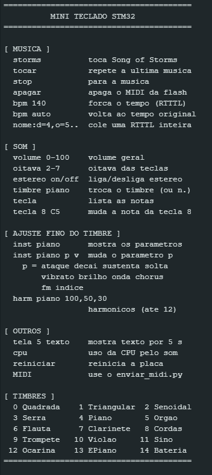</p>

| Comando | O que faz |
|---|---|
| `help` | lista tudo |
| `timbre piano` | troca o timbre (pelo nome ou número) |
| `volume 70`, `oitava 5`, `estereo on` | ajustes |
| `tecla`, `tecla 8 C5` | lista / muda a nota de uma tecla |
| `inst piano`, `inst piano ataque 30` | mostra / muda os parâmetros de um timbre |
| `harm piano 100,50,30` | cria uma forma de onda nova com até 12 harmônicos |
| `tocar` | toca o MIDI guardado na flash (ou a última RTTTL) |
| `storms`, `stop` | toca a música de exemplo / para |
| `apagar` | apaga o MIDI da flash |
| `tela 5 texto` | mostra um texto no display por 5 s |
| `cpu` | mostra quanto da CPU o áudio está usando |
| `reiniciar` | reinicia a placa |

As configurações não são salvas de propósito: ao reiniciar, o teclado volta ao padrão. Só a música MIDI fica guardada.

---

## Músicas RTTTL e MIDI

**RTTTL** (`rtttl.c`) é o formato dos toques de celular antigos: a música inteira numa linha de texto, tipo `nome:d=4,o=5,b=120:c,e,g,8c6`. É só colar no terminal. Toca uma nota por vez.

**MIDI** guarda os eventos da música (qual nota, quando, em qual instrumento, com que força) e não o som, o que encaixa perfeitamente com um teclado que gera o próprio som. O caminho é:

1. O `enviar_midi.py` lê o `.mid` com a biblioteca *mido*, junta todas as trilhas, escolhe um timbre para cada instrumento, separa a bateria (canal 10), converte a força das notas em 4 níveis e manda tudo como texto pela porta COM do Bluetooth.
2. O `midi.c` recebe, guarda cada evento em 4 bytes num buffer de 1 KB e, quando o buffer enche, grava uma página inteira na **flash**.
3. No fim, grava um cabeçalho com nome e duração, e a música começa. Cabem **16.128 eventos** (63 páginas de 1 KB), o suficiente para músicas completas com bateria.

```
pip install mido pyserial
python enviar_midi.py musica.mid COM5
python enviar_midi.py musica.mid --info        # mostra os canais e quantas notas tem cada um
```

> A música fica na segunda metade da flash (0x08010000 a 0x0801FFFF). O datasheet do STM32F103C8T6 fala em 64 KB, mas quase todas as Blue Pill têm 128 KB. Se a sua tiver só 64, o teclado avisa que a gravação falhou.

---

## Como montar e gravar

### CubeMX

Partimos do projeto base do professor (HSE 8 MHz, 72 MHz, SWD, LED no PC13) e acrescentamos:

1. **SYS:** Debug = *Serial Wire* (libera PB3, PB4 e PA15 para as teclas).
2. **GPIO:** PB3–PB9, PA10, PA12, PA15, PA4, PA5 e PA6 como *GPIO_Input* com **Pull-up**.
3. **TIM1:** CH1 e CH2 em *PWM Generation*, Prescaler 0, Counter Period **511**, Repetition Counter **6**, auto-reload preload *Enable*, Pulse 256.
   DMA: **TIM1_UP**, Memory to Peripheral, *Circular*, Half Word / Half Word, prioridade *Very High*.
4. **USART2:** Asynchronous, **115200**, 8N1. DMA: **USART2_RX** (*Circular*, Byte) e **USART2_TX** (*Normal*, Byte). Ative a interrupção global da USART2.
5. **I2C2:** Fast Mode (400 kHz), PB10 / PB11.
6. **Project Manager:** Heap 0x200, Stack 0x800, Toolchain STM32CubeIDE.

As prioridades de interrupção do áudio e do SysTick são ajustadas pelo próprio código, no `audio_init()`.

### STM32CubeIDE

1. Copie `Core/Inc` e `Core/Src` para o projeto gerado e dê *Refresh* (F5).
2. No `main.c`, dentro dos blocos `USER CODE`:
   ```c
   #include "app.h"      /* USER CODE BEGIN Includes */
   app_init();           /* USER CODE BEGIN 2 */
   app_loop();           /* dentro do while(1), em USER CODE BEGIN 3 */
   ```
3. Em *Project > Properties > C/C++ Build > Settings > MCU GCC Compiler > Optimization*, use **-Oz** (otimizar tamanho). Sem isso o programa não cabe nos primeiros 64 KB.
4. Compile e grave com o ST-Link.

### HC-05

O módulo vem de fábrica a 9600 ou 38400. Para passar para 115200, coloque o HC-05 em modo AT (segurando o botão do módulo ao ligar) e escolha **Config HC-05** no menu do teclado. Depois é só desligar e ligar de novo. Para usar, pareie com o celular ou o PC (senha 1234 ou 0000).

---

## Resultados

Uso de CPU pelo áudio, medido na placa com o comando `cpu`:

| Música | Antes da otimização | Depois |
|---|:---:|:---:|
| Sweet Child O' Mine | 78% | 37% |
| Gerudo Valley | 78% | 50% |

<p align="center">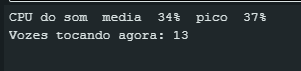</p>

Também testamos o código no computador: o firmware é compilado com versões simuladas do HAL, e um programa de testes aperta teclas, gira o encoder, manda comandos e músicas (incluindo uma de 10.000 eventos gravada na flash) e confere as respostas. Tudo passou, sem nenhuma amostra de áudio batendo no limite do PWM.

---

## Limitações e próximos passos

- O PWM de 9 bits gera um leve chiado de fundo em volume baixo.
- O HC-05 só aceita uma conexão por vez.
- A gravação das músicas depende dos 128 KB de flash da Blue Pill.
- **Próximos passos:** trocar as chaves táteis por switches de teclado mecânico com keycaps e colocar tudo numa carcaça impressa em 3D.

---

## Créditos

- **Equipe:** Felipe Fidel Fleck, Pedro Henrique Pascotto Dahmer e Thiago Biazus Maran.
- **Professor:** Kleyton Hoffmann, que sugeriu o PWM no lugar do DAC.
- **Biblioteca do display:** [afiskon/stm32-ssd1306](https://github.com/afiskon/stm32-ssd1306), licença MIT (ver `Core/LICENSE_ssd1306_MIT.txt`).
- Usamos o **Claude Opus 5.5** (Anthropic) como apoio técnico na migração do ESP32 para o STM32, no DMA, na síntese de som, no script de envio de MIDI e nas simulações. A montagem, a configuração no CubeMX, os testes na placa e as decisões do projeto foram nossos.
